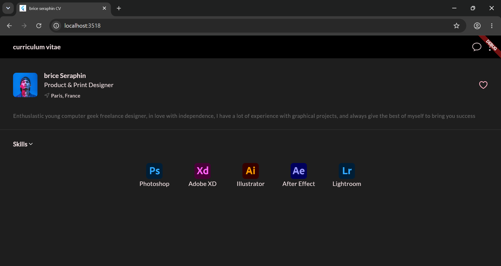

# Flutter CV App

A personal CV / portfolio screen built with Flutter, practicing UI layout and state management from a design mockup.





## Features

- Dark theme generated from a seed color (Material 3)
- Custom typography with Google Fonts (Lato)
- Profile header with avatar, title and location
- Interactive skills section: tap a skill to highlight it with a glow effect
- Layout built with Row, Column, Expanded and Wrap

## Tech Stack

- Flutter / Dart
- google_fonts
- Cupertino icons

## Run Locally

```bash
git clone https://github.com/mjkkn03/flutter-cv-app.git
cd flutter-cv-app
flutter pub get
flutter run -d chrome
```

## Note

This is a practice project: the UI is implemented from a course design mockup to learn Flutter widgets and layout.
